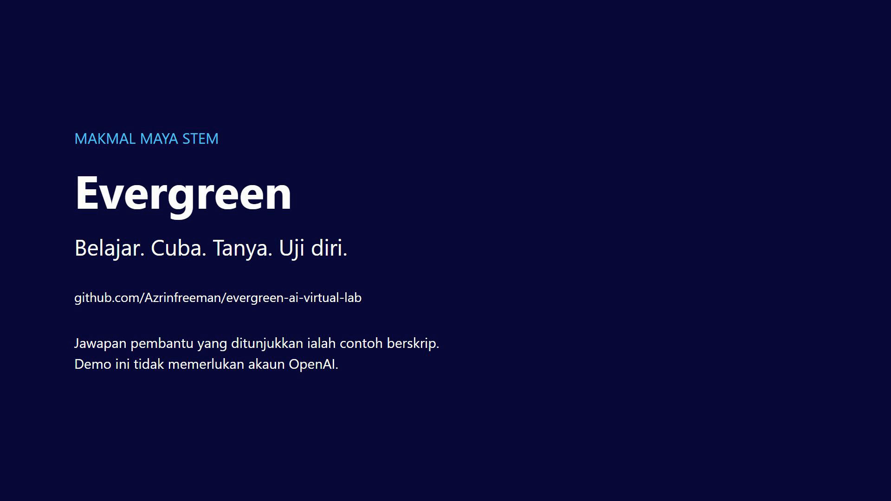

# Evergreen STEM VirtualLab

A 2D Unity virtual science lab for secondary-school students, written in **Bahasa Malaysia** (KPS curriculum). Students work through guided lessons, run drag-and-drop lab experiments, test themselves with quizzes, and ask an **AI science tutor** questions at any point.

  

## Download

A Windows 64-bit pre-release build is on the [Releases page](https://github.com/Azrinfreeman/evergreen-ai-virtual-lab/releases/tag/v0.1.0-ui-revamp). Unzip it, keep all files together, and run `Evergreen.exe`. The downloaded build uses the tutor's scripted demo answers and never calls OpenAI.

## What it does

| Area | Details |
|---|---|
| **Dashboard** | Seven activities (Aktiviti 1–7). Each hub has three stations: *Belajar teori* (lesson pages with a "Halaman N daripada M" indicator), *Mula eksperimen* (experiment, where applicable) and *Uji diri* (quiz). Finished stations show a "Selesai" chip. |
| **Experiments** | Five interactive labs (`akt3`–`akt7`), including DNA cloning, microbial fuel cells and rubber-film technology. Apparatus is dragged onto targets; each step checks the action before moving on. Steps show "Langkah N daripada M" and a "Langkah selesai" chip when done. |
| **Quizzes** | Seven *Uji Diri* quizzes with "Soalan N daripada M", progress pills, the learner's own pick marked, a coin score, retry, and a result summary. The maximum score comes from each quiz's real question count. |
| **Tetapan** | A settings chip in every scene: *Kurangkan gerakan* (reduce motion) and *Bunyi* (sound). Both are saved on the device. "Set semula kemajuan" clears local progress. |
| **AI tutor** | A floating "Pembantu pembelajaran" chat assistant, available on every screen. |

Flow: `LoginPage` → `Dashboard` → `Experiments/aktN` or `Quiz/Uji Diri N` → back to `Dashboard`.

Progress is stored only on the device that played. The only network calls come from the AI tutor, and only in the Editor with a key set.

## Teaser: a learner's journey

[](trailer/out/player-journey-teaser.mp4)

[Watch the teaser](trailer/out/player-journey-teaser.mp4) (1080p60, 74 seconds). It follows a learner through the real app: login, choosing Aktiviti 4, a lesson, dragging apparatus in the lab, asking the assistant two questions, and finishing with the Uji Diri quiz.

## Earlier trailer

[](https://youtu.be/xLwLS0q_fRw)

[Watch the trailer on YouTube](https://youtu.be/xLwLS0q_fRw) or the [10-second silent tutor loop](trailer/out/readme-loop.mp4).

**About the tutor in the videos:** the assistant's answers in the teaser, the trailer and the loop are the app's scripted demo replies, not OpenAI output, and the teaser works without an OpenAI account. A live OpenAI tutor needs your own key in the Editor (see [`docs/OPENAI_SETUP.md`](docs/OPENAI_SETUP.md)).

## AI in this project

### 1. In-app AI tutor (OpenAI)
- Built on the [OpenAI-Unity](https://github.com/srcnalt/OpenAI-Unity) package (`Assets/Samples/OpenAI Unity/0.2.2/ChatGPT/ChatGPT.cs`).
- **Context-aware system prompts**: the assistant picks a prompt per screen (Dashboard, Akt1–Akt7, MM3–MM7) so answers stay on the topic the student is studying.
- **Scoped behaviour**: the tutor answers only science questions and stays in character as a scientist.
- Async request flow with a Malay status line ("Sedang menyediakan jawapan…"), error and empty-response handling, and input locking while a reply is pending.
- The assistant lives in a persistent `DontDestroyOnLoad` canvas, so it survives every scene change without duplicating.
- **API key handling**: the key is read from the `OPENAI_API_KEY` environment variable, falling back to `~/.openai/auth.json`. No key is stored in the project. See [`docs/OPENAI_SETUP.md`](docs/OPENAI_SETUP.md).
- **Release builds are demo-only**: a player build that is not a Development build (and not the Editor) never calls OpenAI. It always uses the scripted replies, even if a key is set on the machine. The `Allow Live In Release` option on the `ChatGPT` component is off by default. Turn it on only for a build that talks to your own backend. A live tutor in a shipped build therefore needs that backend; see [`docs/OPENAI_SETUP.md`](docs/OPENAI_SETUP.md).
- **Scripted demo mode**: without a key in the Editor, `Auto` uses fixed sample answers so the chat flow can still be tried. These answers are not model output. To edit them or force demo mode, see [`docs/tutorial/tutor-demo-mode.md`](docs/tutorial/tutor-demo-mode.md).

### 2. AI-assisted development workflow (Claude Code + Unity MCP)
The project was built and revamped with AI coding agents driving the Unity Editor directly through the [Unity MCP](https://github.com/CoplayDev/unity-mcp) bridge:
- Scenes, prefabs and UI were inspected and edited programmatically (hierarchy queries, component edits, play-mode screenshots).
- The UI revamp is documented in [`IMPLEMENTATION.md`](IMPLEMENTATION.md): the stage-by-stage status, the verification matrix and the evidence for each change.
- The rules agents follow are in [`AGENTS.md`](AGENTS.md). Their working notes are kept out of the repository.

## Tech stack
- Unity 6 (6000.6.x), uGUI + TextMeshPro, 2D physics for drag/drop triggers
- C# (`DragController`, `ItemSlot`, `NextExperimentController`, `QuestionController`, `MenuSlideController`, `UiProgress`, …)
- OpenAI-Unity (chat completions), Unity MCP (CoplayDev)

## Getting started
1. Install **Unity 6** (see `ProjectSettings/ProjectVersion.txt` for the exact version) and open this folder.
2. Open `Assets/Scenes/LoginPage.unity` and press Play.
3. Optional, for the AI tutor in the Editor: set your key before launching Unity.
   ```powershell
   setx OPENAI_API_KEY "<your key>"
   ```
   Restart Unity afterwards. Without a key, `Auto` uses the scripted demo answers and the rest of the app still works. Full guide: [`docs/OPENAI_SETUP.md`](docs/OPENAI_SETUP.md); demo answers: [`docs/tutorial/tutor-demo-mode.md`](docs/tutorial/tutor-demo-mode.md).
4. Experiments and quizzes can be opened directly from `Assets/Scenes/Experiments/` and `Assets/Scenes/Quiz/`. The persistent assistant is created by the Dashboard, so enter through it to see the tutor.

Editing guides for the feel and settings components are in [`docs/tutorial/ui-feel.md`](docs/tutorial/ui-feel.md).

## Project layout
```
Assets/
  Scenes/                  LoginPage, Dashboard, Experiments/akt3–7, Quiz/Uji Diri 1–7
  UI/Dashboard/            Dashboard artwork
  UI/Science/Scripts/      Science UI: motion, focus, sound, settings and local progress
  UI/Science/Prefabs/      Shared assistant overlay (brain button, Tetapan, chat box)
  prefabs/                 Apparatus and chat prefabs
  Samples/OpenAI Unity/    AI tutor and demo-mode tutor
docs/                      Setup, tutorial and curriculum-review notes
trailer/                   Trailer capture scripts, editing project and outputs
IMPLEMENTATION.md          Science UI revamp status and evidence log
```

## Status
Pre-release. The science-themed UI revamp is implemented across the Dashboard, all five experiments and all seven quizzes, and a Windows build is published. Still open: a full hands-on playthrough with mouse and keyboard, audio checks in every experiment, the six-resolution check on the newest pages, and the teacher review of the akt7 science content. See [`IMPLEMENTATION.md`](IMPLEMENTATION.md) for what is verified and what is open.

## Author
Azrin Freeman
