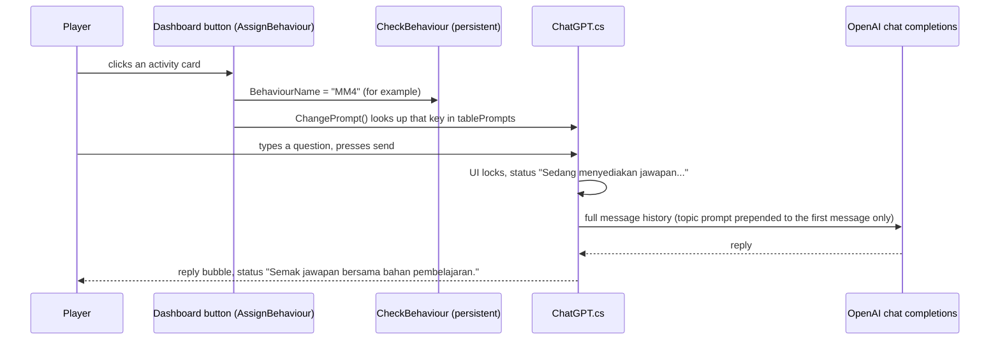
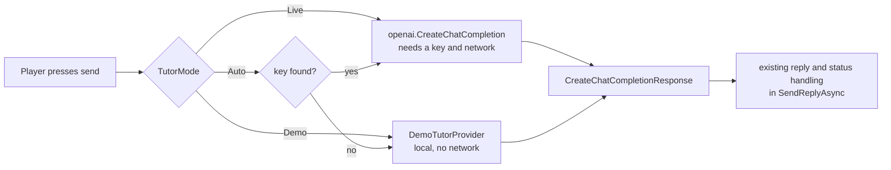

# Evergreen player-journey teaser — implementation plan

Updated: 2026-11-12. **First local cut rendered: 74.2 seconds; final review remains open.** The chat uses the scripted demo tutor (owner decision), so no OpenAI account is needed. Current verification and production evidence is recorded under [Status and human editing guide](#status-and-human-editing-guide); unchecked tasks remain unfinished.

**Goal:** Make a new teaser that shows how a learner actually uses Evergreen, with the built-in AI tutor chat (scripted demo replies, no OpenAI account) as the main feature and lessons, experiments, and quizzes as the connected learning journey.

**Architecture:** Reuse the existing Windows capture scripts and Remotion editing project. Add a separate teaser composition and new takes, preserving the existing 50-second trailer, README loop, and their sources. Capture actual app interactions; keep captions, shot timings, crops, and audio cues editable in TypeScript.

**Tech stack:** Unity 6000.6.7f1, existing uGUI chat, PowerShell input/capture helpers, ffmpeg, and the existing React/Remotion project in `trailer/edit/`.

**Brief and references:** The user's 2026-11-12 request is the brief: a player-use teaser, chatbot/OpenAI interaction given priority, other important features included, implementation Markdown first, no execution yet. [README](../../README.md), [OpenAI setup](../OPENAI_SETUP.md), [demo tutor guide](../tutorial/tutor-demo-mode.md), and the [UI revamp implementation log](../../IMPLEMENTATION.md) describe the existing product. The writing-plans and game-trailer skills inform the staging and editorial checks; browser-game capture examples are adapted to this existing Unity pipeline.

This proposal governs the **new teaser only**. The earlier plan and production notes remain under [Historical trailer record](#historical-trailer-record). Its old unchecked items, obsolete baseline, and approvals do not define the new teaser's status.

## Scope and creative direction

- Audience: students and people viewing the project demonstration. Show a learner's task and actions clearly, including when and why they ask for help.
- Target: **65 seconds**, 1920 × 1080, 60 fps, landscape. Allow up to 75 seconds if genuine reply text needs more reading time; shorten secondary shots before shortening chat readability.
- Language: Malay captions and existing Malay UI. Working line: **“Belajar. Cuba. Tanya. Uji diri.”**
- Style: Evergreen navy, blue, cyan, existing laboratory imagery and typography. Real cursor movement, readable screen holds, straight cuts and short fades. Modest crops draw attention to apparatus and chat after establishing the full screen.
- The first cut gives chat **41.2 seconds of 74.2**, including opening, typing, sending, pending states, both scripted replies and the follow-up. The learner then closes it and resumes the lab.
- Keep narration out of the first cut so viewers can read the app. Use music and restrained action sounds; the complete story must also work muted.
- Include login/entry briefly, activity choice, a lesson, real apparatus interaction, chatbot, return to the task, and quiz feedback/score. Settings and completion indicators can appear naturally; they do not need separate feature cards.
- No developer architecture segment, code/Inspector footage, decorative scientific graphics, generated gameplay, new app features, backend work, or release/publishing changes in this scope.

## Current source findings and capture constraints

Read-only inspection on 2026-11-12; these findings do **not** establish current runtime success.

| Source | Finding and consequence |
|---|---|
| `trailer/edit/src/Trailer.tsx` and `Root.tsx` | Existing 50-second trailer and separate loop are registered. Some existing footage is sped up. The new composition will use new takes and normal-speed learning actions. |
| `trailer/capture/transcripts/tutor_takes.md` | Previous chat recordings used `Mode = Demo` with the demo notice hidden. The new teaser also uses scripted replies, but keeps the notice visible and labels them as demo answers. |
| `ChatGPT.cs` under `Assets/Samples/OpenAI Unity/0.2.2/ChatGPT/` | `ResolveTutorMode()` forces ordinary release builds to scripted replies unless explicitly overridden. Use a separate **Development** capture build launched with `-tutor-demo` (added 2026-11-12), which forces scripted replies regardless of any key; leave the release lock intact. |
| Same script, `SendReplyAsync()` | The selected prompt is prepended to the first user message; conversation history is retained. Show one selected activity and a follow-up in the same conversation. Do not imply automatic awareness of new scenes or steps. |
| `AssignBehaviour.cs` and `CheckBehaviour.cs` in the same folder | Button callbacks supply the topic key and call `ChangePrompt()`. Verify the current Dashboard route sets `MM4` before the first question. |
| `Assets/Scenes/DontDestroyCanvas.cs` | The overlay persists across scenes. Enter through LoginPage → Dashboard; check for a single chat overlay and correct input focus. |
| `trailer/capture/Drive.ps1` | Existing rig assumes a borderless 1920 × 1080 player at desktop origin, records desktop pixels, and kills processes named Evergreen. Verify framing/DPI and change process ownership before unattended reuse. |
| `trailer/capture/Take-Tutor.ps1` | Coordinates and fixed five-second response wait belong to the older UI/demo take. Recalibrate and use response-state checks with a bounded timeout for live capture. |
| `.gitignore` | New raw footage and output filenames are ignored. Only the three old README deliverables are exempted. Deliver the teaser locally first; do not change tracking or README links during production. |

Existing unrelated local changes include project settings, TMP font data, adaptive-performance assets, screenshots, and `docs.zip`. Preserve them. Record the capture commit and relevant pre-existing changes so the footage's source is identifiable; do not stage or reset unrelated files.

## Chatbot approach: scripted demo replies

**Owner decision, 2026-11-12: the teaser uses the app's scripted demo tutor. No OpenAI account, key or network call is used for any take.** This supersedes the earlier proposal to record a live OpenAI exchange; the live-capture steps are retired.

1. **Forced in code, not by luck.** `ChatGPT.cs` accepts a `-tutor-demo` launch argument. A player started with it always uses the scripted replies, even a Development build and even if `OPENAI_API_KEY` or `~/.openai/auth.json` exists. `trailer/capture/Drive.ps1` passes the flag on every launch and clears `OPENAI_API_KEY` for the child process. The player log must show `Tutor mode: Demo (-tutor-demo)`; a take is rejected if it shows any other mode.
2. **The replies are real app output, but they are fixed text.** The scripted answers come from `Demo/DemoTutorScript.asset`, matched to the question by keyword for the active topic. They are not model output, and the film must not present them as such.
3. **Keep the notice visible.** Leave `Hide Demo Notice` off so the status line says demo mode is on after each reply. The earlier trailer's hidden notice is not reused. Do not turn the notice off for footage.
4. Start a fresh app session per take, select Aktiviti 4's experiment route, and verify `MM4` before asking anything. Ask two connected questions in that conversation. Do not change topic mid-conversation.
5. Questions: **“Apakah fungsi enzim sekatan dalam eksperimen ini?”** then **“Bagaimana pula fungsi DNA ligase?”** Both match entries in the `MM4` script (keywords `enzim`/`sekatan` and `ligase`). Re-check them against the script before each capture; if an entry changes, change the question, not the answer.
6. Record the exact returned text and timestamps in the transcript. Never rewrite or composite an answer into the chat UI. Keep scrolling visible when needed.
7. Waiting can be trimmed with a visible edit and a small **“Masa menunggu dipendekkan”** label. Retain a recognizable pending state ("Sedang menyediakan jawapan…"). Do not imply streaming or instant response.
8. Do not claim that the film shows OpenAI, a model, or model-quality answers. If a viewer might read it as live AI, the end card wording below fixes that.

Use a plain **“Pembantu pembelajaran · Jawapan demo”** editorial label during the chat segment. The closing qualifier must state **“Jawapan pembantu dalam video ini ialah contoh berskrip (mod demo). Sambungan OpenAI memerlukan kunci anda sendiri.”** Repeat the distinction in the eventual delivery description. Give the qualifier at least four readable seconds; extend the end card if the preview shows it needs more time.

## First-cut running order

These are the implemented edit timings, not capture durations. Source in/out points are editable in `TEASER_SHOTS`; the continuous underlying take and event marks are preserved separately. Navigation is visibly cut; both pending response intervals remain at normal speed.

| Time | Player action and framing | Proposed Malay caption / purpose |
|---|---|---|
| 00–02 | Apparatus action as an opening preview of the later interaction. | “Makmal sains maya · Evergreen STEM” |
| 02–07 | Enter from LoginPage; full Dashboard, then select Aktiviti 4. | “Masuk makmal” / “Pilih aktiviti” |
| 07–09.5 | Hold the cloning lesson's reading page. | “Fahami konsepnya” |
| 09.5–15.5 | Full workspace and first real label drag/drop. | “Cuba sendiri, langkah demi langkah” |
| 15.5–26.9 | Open the assistant, type/send question one and retain the pending state. | “Perlukan penjelasan? Tanya pembantu.” |
| 26.9–39.9 | Crop toward the complete first scripted answer and visible demo notice. | “Pembantu pembelajaran · Jawapan demo” |
| 39.9–56.7 | Type/send the follow-up, retain its pending state and hold the complete second answer. | “Teruskan dengan soalan susulan” / “Pembantu pembelajaran · Jawapan demo” |
| 56.7–62.2 | Resume the second label drop and show real step-complete feedback. | “Kembali ke eksperimen” |
| 62.2–69.2 | A deliberate answer in Uji Diri 4, marked feedback and genuine score change. | “Uji kefahaman anda” |
| 69.2–74.2 | Evergreen title, project location, working line and scripted-demo disclosure. | “Belajar. Cuba. Tanya. Uji diri.” |

The two chat replies must fit a comfortable reading pace, initially budgeted at no more than about three Malay words per second. Measure the selected text and extend the holds when needed. Do not rush the typing or answers to match a music bar. If the two-turn exchange cannot fit within 75 seconds, return with a revised timing proposal before dropping the follow-up.

## File ownership and planned changes

The capture script, transcript and new composition below now exist. Export/review status is recorded in the latest execution evidence; the original trailer and loop remain intact.

| File / location | Planned responsibility |
|---|---|
| Existing `trailer/capture/Drive.ps1` | Implemented preparation: optional executable/log paths with original executable default preserved; visible interactive player, hidden ffmpeg; stop only the owned player; bounded startup, focus and physical window checks. `-Supervised` permits desktop-tool activation before input; input guards still apply. Production capture still needs continuous focus monitoring. |
| Existing `trailer/capture/Take-Tutor.ps1`, `Take-Akt4.ps1` | Reference for actions and routes. Preserve old takes; share helpers where useful. |
| New `trailer/capture/Take-PlayerJourney.ps1` | New route-aware capture: entry, activity, lesson, lab, two-turn tutor exchange, return, quiz. Record segment marks; use UI/state evidence rather than fixed demo waits. Abort on focus loss, wrong topic, any tutor mode other than `Demo (-tutor-demo)`, timeout or error. If robust automated state checks are unavailable, use supervised capture and record that limit. |
| New `trailer/capture/transcripts/player-journey-teaser.md` | Take filenames, build/commit and date, topic, actual mode/model, exact two-turn exchange, event times and selected in/out points. No credentials or personal chat. |
| New `trailer/raw/player-journey/` | New original captures, kept separate from old takes and ignored by git. QA stills/contact sheets go under `Temp/qa_screens/teaser/`. |
| New `trailer/edit/src/PlayerJourneyTeaser.tsx` | One owned composition containing the shot table, captions, crop targets, audio cues and end card. Avoid a new editing framework or duplicate app UI. |
| Existing `trailer/edit/src/Root.tsx`, `package.json` | Register `PlayerJourneyTeaser` and add distinct `teaser` / `teaser:preview` render scripts; preserve `Trailer`, `ReadmeLoop` and their existing scripts. |
| Existing `trailer/edit/scripts/gen-score.mjs`, `gen-cue.mjs` | Reuse score/cue generation. If the score needs a longer arrangement, add optional duration/output settings with unchanged defaults; never overwrite old audio unintentionally. |
| New `trailer/edit/scripts/master-teaser.mjs` | Reproducible two-pass audio mastering, H.264/yuv420p packaging, measured video duration and loudness sidecar; refuses an existing delivery path. |
| Ignored `trailer/edit/public/player-journey/` | Remotion media staged from the new original captures and audio. The transcript records the source-to-staged mapping. |
| New local `trailer/out/player-journey-teaser.mp4`, `player-journey-teaser-preview.mp4`, `player-journey-teaser-poster.png` | Final, review copy and poster. Leave ignored until the user requests repository/public delivery. |
| Existing `docs/trailer/IMPLEMENTATION.md` | This plan and later evidence/checklist updates. |

`README.md`, `docs/trailer/PUBLISHING.md`, tracked media, game scripts, scenes and prefabs are outside the planned persistent changes. Publishing copy or README replacement can follow the user's review of the completed teaser.

## Implementation stages and acceptance checks

Execution was authorized on 2026-11-12. Check tasks only after their acceptance checks pass; preparation alone does not establish capture or runtime success.

### 1. Verify the player journey and scripted tutor

- [ ] Read current Unity hierarchy/callbacks for the chosen route and confirm `MM4`, a single persistent overlay, current chat layout, question input and button behaviour. Check the chosen apparatus and quiz text against the actual app.
- [x] Confirm the existing local ffmpeg, Node, locked Remotion dependencies, ignored capture folders, disk space and Windows build target. Do not install a replacement pipeline or change build targets without a demonstrated need.
- [x] Produce a separate Development capture build, launch it with `-tutor-demo` through LoginPage → Dashboard, and complete one two-question exchange. Confirm the player log shows `Tutor mode: Demo (-tutor-demo)` and that no request reaches OpenAI. Check input locks while pending and restores after a reply; inspect Console/player errors.
- [x] Rehearse lab → chat → resume → quiz with real input at 1920 × 1080. Verify the bot does not block the apparatus once closed and the quiz score is genuine. Stage passes only when the whole route and the scripted replies work.

### 2. Record the new takes

- [ ] Update the capture helpers narrowly and recalibrate coordinates against the current UI/DPI. Smoke-record ten seconds first; verify cursor, framing, text and playback. Do not run the legacy blanket process-kill behaviour.
- [x] Capture fresh material for the complete running order. Use a fresh conversation for each attempt. Scripted replies are deterministic, so retake only for timing, focus or framing problems.
- [x] Save the complete selected exchange, marks, mode/model and source mapping in the new transcript. Verify the filmed apparatus and answer wording; no new curriculum claims or unsupported hints.
- [ ] Inspect contact sheets and full chat clips. Reject desktop leaks, errors, unreadable replies, focus failures, dropped actions, a hidden demo notice, or any tutor mode other than the scripted one. Chat capture passes only with both turns readable and the demo notice visible.

### 3. Edit the teaser and mix audio

- [x] Build `PlayerJourneyTeaser.tsx` and register its composition. Keep timings, captions and crop positions in a clearly named shot table; derive duration from the timeline to avoid a clipped ending.
- [ ] Use normal-speed important actions and visible cursor paths. Establish each screen before cropping; keep apparatus, typed question, reply and scroll motion clear. Limit transitions to short fades/cuts; let reading time govern pacing.
- [ ] Reuse the score at a restrained level, with lower music during chat. Align UI sounds to visible actions; avoid synthetic reply cues that imply guaranteed correctness. Keep any retained captured audio and added cues from doubling the same click.
- [ ] Render representative stills including the longest answer and end card. Check 1080p and a 720p viewing size, caption boundaries, Malay glyphs, muted comprehension, and the development/demo qualifier.
- [x] Run `npx tsc --noEmit` in `trailer/edit/` using the existing dependencies, then render the new preview. Expected: typecheck and new composition render succeed without changing old composition IDs or outputs.

### 4. Review and deliver locally

- [ ] Watch the complete preview with sound and muted. Compare the chat frames to the transcript; check sequence continuity, actual loading states, answer reading time, scroll limits and the return to gameplay. Contact sheets supplement full playback.
- [ ] Inspect the full export for exposed credentials/personal material and every promotional claim for accuracy. No screen vision, progress awareness, guaranteed correctness, live public-release service, streaming, OpenAI or model-name claims.
- [x] Check final metadata with ffprobe: 1920 × 1080, 60 fps, H.264/yuv420p with AAC audio, duration matching the composition. Deliver a 1280 × 720 preview targeting under 20 MB and a poster from an actual frame. If source capture drops frames, recapture important actions rather than claiming native 60 fps motion from duplicated frames.
- [ ] Measure audio with ffmpeg loudness analysis; target about -18 to -16 LUFS integrated and true peak at or below -1 dBTP. Listen for clipping, abrupt cuts and distracting cues.
- [ ] Review the final diff and record build/take identity, resolutions, actual interactions, tools/checks run, output paths, duration and untested limits here. Confirm ordinary release behaviour and original trailer outputs were preserved.
- [ ] Deliver local files and editable source locations for user review. Do not commit, push, replace the README trailer, upload a video, or modify the GitHub release without a separate request.

## Review focus and failure handling

| Risk | Required evidence / response |
|---|---|
| Scripted replies presented as OpenAI output | Log shows `Tutor mode: Demo (-tutor-demo)`, notice kept visible, label "Jawapan demo", and the closing qualifier. No OpenAI or model claims in captions or description. |
| Long or scientifically questionable answer | Compare with lesson/procedure; retain full text, retake or extend. Never improve the answer through video compositing. |
| Stale topic after prior conversation | Fresh launch and verified `MM4` before first send. Keep the follow-up in that same topic/session. |
| UI changed since old coordinate scripts | New 1080p rehearsal and ten-second capture; fail on focus/framing errors. Do not reuse old positions blindly. |
| Edited wait implies instant output | Keep the real pending state and disclose shortened waiting at the cut. |
| Demo download confused with footage | The footage is also scripted; the qualifier and delivery description say so. Retain the release lock. |
| Music/captions make chat hard to follow | Full sound-on and muted preview; 720p reading check and measured holds. |
| Unrelated workspace changes lost or included | Baseline inventory and final focused diff; no reset/staging of the user's existing changes. |

## Status and human editing guide

### Execution evidence — 2026-11-12

Source baseline: commit `9497732d4a30a7489b5ea143c23533aceae026ed` plus the pre-existing local changes listed above. Loaded Dashboard scene was clean before the build. Unity 6000.6.7f1 was responsive and configured for `StandaloneWindows64` with LoginPage first among the enabled scenes.

- **Build:** separate Development player at `Temp/PlayerJourneyCapture/Evergreen.exe`; Unity build job `build-84a6c25d89` succeeded in 14.54 seconds with 0 errors and 0 warnings. No scene/prefab override or release-lock change was required: the inspected tutor prefab uses Auto and `Allow Live In Release = false`. Final Editor Console check returned 0 errors; the pre-existing Input Manager deprecation warning was observed separately.
- **Tools:** Node `v24.22.1`, ffmpeg/ffprobe `9.0.2`, Remotion/CLI `4.0.541`, TypeScript `7.0.2`. Installed editing packages match `package-lock.json`; no dependencies were installed. About 89.7 GB was free on D: at preflight. Git ignore checks passed for the new raw, staged-media and output paths.
- **Real player rehearsal:** physical borderless window bounds verified as `(0,0)–(1920,1080)`. Windows desktop-tool screenshots are 1280 × 720 logical pixels at the current display scaling; legacy PowerShell cursor coordinates use physical pixels. Tested LoginPage → Dashboard → Aktiviti 4 → lesson pages 1–2 → back through page 1 to the activity hub → experiment. Returning via Laman utama and reselecting the activity retains the lesson page, so the recording route must use the lesson's own back controls to regain its hub.
- **Lab and quiz:** opened and closed the assistant, then entered experiment 4; both real label drops succeeded, `Langkah selesai` appeared and Seterusnya advanced from step 1 to step 2. Returned through Dashboard to Uji Diri 4; selecting the third answer on question 1 advanced to question 2, displayed `Betul`, and changed the score from 0 to 10. This is a rehearsal of selected actions, not a full experiment/quiz completion or successful two-turn tutor journey.
- **Capture helpers:** `Drive.ps1` no longer kills every process named Evergreen. It supports an explicit executable and log path, validates player focus and physical framing before input, releases a held drag button on failure, rejects an existing recording filename, and stops only the player it launched. Shell focus acquisition failed safely during preflight; supervised desktop activation then passed the same focus/framing checks. Repeated dot-sourcing, the missing-player guard and PowerShell parsing passed. After rehearsal, the owned player was stopped and the Editor remained open. Unattended full-take automation is not yet verified.
- **Smoke recording:** `trailer/raw/player-journey/smoke-lab-01.mp4` is QA only: H.264, 1920 × 1080, 10.000 seconds, nominal 60/1 frame rate, but only **382 encoded frames**, not the intended 600. An extracted frame was visually inspected for legible UI and cursor. It also has a thin capture-indicator border along the top/left. Do not use it as production footage or claim native 60 fps motion. Recapture after improving cadence and removing the capture outline; verify full playback before accepting a take.

QA images: `Temp/qa_screens/teaser/live-quota-failure.png`, `lab-step1-complete.png`, `quiz-score-10.png`, and `smoke-frame.png`. The first three are desktop-tool logical-resolution screenshots; `smoke-frame.png` is extracted from the physical 1080p recording. The player log is local at `Temp/PlayerJourneyCapture/player.log`.

### Tutor source resolved: scripted demo mode (2026-11-12)

The earlier live rehearsal returned **`insufficient_quota`** ("You have no credits remaining"), so no OpenAI exchange was captured. **Owner decision: the teaser does not connect an OpenAI account at all; the tutor uses the scripted demo replies.** That quota failure is no longer a blocker, and no billing or credential change is needed.

What was changed to guarantee it:
- `ChatGPT.cs` accepts a `-tutor-demo` launch argument. A player started with it always uses the scripted replies, in a Development build too, and ignores `OPENAI_API_KEY` and `~/.openai/auth.json`. The log line is `Tutor mode: Demo (-tutor-demo)`.
- `trailer/capture/Drive.ps1` passes `-tutor-demo` on every launch and clears `OPENAI_API_KEY` for the child process.

Verified with a rebuilt Development player at `Temp/PlayerJourneyCapture/Evergreen.exe` (build succeeded, 0 errors): launched with a **fake** `OPENAI_API_KEY` set and `-tutor-demo`, then LoginPage → Dashboard → assistant opened → one question sent through the real UI. The player log shows `Tutor mode: Demo (-tutor-demo)` with 0 OpenAI, quota or 401 lines and 0 exceptions, and the chat returned a scripted reply with the notice **"Mod demo: jawapan contoh, bukan daripada model AI."** (QA stills `Temp/qa_screens/chat-open-shot.png`, `reply-shot.png`; logs `tutor-demo-flag-check3.log`, `-check4.log`.) That run had no activity selected, so the matcher used its generic fallback; the production route selects Aktiviti 4 first so the `MM4` entries apply.

Capture note: the player log is only fully written on a graceful close (`CloseMainWindow`), not after a forced kill. Use a graceful close before reading logs.

That was the status at the end of the demo-flag change. The next execution entry supersedes its remaining-work list.

### Full demo rehearsal and first edited take — 2026-11-12

Completed the real-input LoginPage → Dashboard → Aktiviti 4 lesson → experiment → two-question demo conversation → resume apparatus → quiz route at physical 1920 × 1080. Both `MM4` answers matched the existing scripted content. Pending input/send states and restored controls were observed, the notice stayed visible, the resumed second label produced `Langkah selesai`, and the quiz changed from question 1/score 0 to question 2/score 10. A very fast desktop-tool drag did not register; the existing smooth-drag helper succeeded and is used in the production script. This validates the filmed journey, not all 12 procedure steps or all quiz questions.

`trailer/capture/Take-PlayerJourney.ps1` now records the rehearsed route, polls focus/framing during holds, verifies demo mode and the experiment-4 prompt in the player log, saves event marks and four checkpoint stills, and rejects reused take names. It remains a supervised capture script: the filmed text/score require review, rather than being inferred from fixed waits. `Drive.ps1` retains its old GDI default; the new take selects Desktop Duplication, uses four-pixel overscan to exclude the capture outline, and records explicit CFR output. Shutdown now requests a graceful close before a bounded force-stop fallback. The parent shell's credential environment value is restored after launching a child without it; the demo flag still forces the non-network branch.

Fresh source: `trailer/raw/player-journey/journey-01.mp4`, 150.000 seconds, 1920 × 1080 H.264/yuv420p, **9,000 frames at 60 fps**. ffmpeg reported **96 duplicated / 2 dropped** frames during timestamp resampling, so this is not evidence of native 60 fps gameplay. Full decode to null passed. Both answer checkpoints, resumed completion, quiz score, the five-second contact sheet and an extracted encoded answer frame were inspected. The encoded frame excludes the Windows outline without replacing app content.

The take's final marker falsely says rejected: PowerShell returned a null exit code because the process handle had not been retained. The file was recovered for editing after inspecting ffmpeg's normal completion, ffprobe metadata, full decode and checkpoints. The original marker remains in the source marks; the script now retains the native handle and waits for completion. A separate process-handle check returned exit code 0; a second full take with that fix has not been run. The player log contains `Tutor mode: Demo (-tutor-demo)` and the matching cloning prompt, with no API error or exception lines found. No live request was attempted for this rehearsal or take.

The [take transcript](../../trailer/capture/transcripts/player-journey-teaser.md) records exact replies, source identity, event times, staging map, recovery evidence and capture limits. QA output remains under `Temp/qa_screens/teaser/`.

The new `PlayerJourneyTeaser` composition is **74.2 seconds**, with normal-speed actions, 13- and 10-second answer holds (31 and 25 words), explicit scripted-demo captions and a five-second end disclosure. `TEASER_SHOTS` owns timings/crops/captions. The old composition IDs/scripts remain available. The existing score generator accepts an optional bar count while retaining its 20-bar default; a separate 30-bar score was generated for this take. TypeScript passed; answer/end-card stills were rendered and visually checked at 720p. The first preview render exposed a floating-point scale error; its script now uses `0.6666666666666666`, giving exact 1280 × 720 dimensions.

The corrected preview rendered successfully and its full contact sheet was inspected. `trailer/out/player-journey-teaser-preview.mp4` is **1280 × 720, 60 fps, 4,452 video frames, exactly 74.200 seconds**, limited-range H.264/yuv420p with AAC audio; size **3,843,297 bytes**. Full preview decode passed. `scripts/master-teaser.mjs` adds reproducible two-pass loudness normalization and standard video packaging without overwriting its input or an existing delivery. Measured preview loudness is **−16.96 LUFS integrated / −1.48 dBTP**; the evidence JSON is beside the MP4. An initial 0.1-second loudness-filter tail was removed by deriving export duration from the video stream. Run `npm run teaser:preview` then `npm run teaser:preview:master` to reproduce the preview, and the equivalent `teaser` then `teaser:master` for the master. The full-resolution Remotion render is in progress.

The collaborative browser returned `Authentication required` for both status and open calls; local Remotion Studio was started at `http://localhost:3000` and its CLI opened the installed browser. Browser playback has not been verified. The mastered local preview opened in PotPlayer, showed normal playback at the opening and second-reply segment, and advanced to the next file after reaching its end. The review player was then closed. This is observed playback plus sampled visual/contact-sheet review, not an uninterrupted sound-on and muted quality review. No commit, push, README replacement or release/publishing operation was performed during this execution slice.

**Local delivery:** `trailer/out/player-journey-teaser.mp4` is 1920 × 1080, H.264/yuv420p, AAC, 60 fps, **4,452 frames / exactly 74.200 seconds**, **5,591,510 bytes**. Mastering measured **−16.96 LUFS / −1.48 dBTP**. Full decode passed. The second-reply frame and `player-journey-teaser-poster.png` (actual frame at 71 seconds, 1920 × 1080) were visually inspected. The mastered 720p preview above is the review copy. Both MP4s have matching audio/video stream durations and separate loudness sidecars. The old trailer, loop, poster, composition sources and README have no diff from this slice. New exports/raw media remain ignored; editable source changes remain local and uncommitted.

Remaining before calling the teaser finished: uninterrupted sound-on and muted review, subjective audio/transition review, and final review of framing/continuity and all promotional claims. The first draft currently uses music only; synchronized UI sound cues are not implemented. Detailed overlay/hierarchy checks and a second end-to-end capture after the exit-code fix remain unverified. The task has produced a reviewable local cut; these open checks are not claimed complete.

After implementation, common edits belong in `PlayerJourneyTeaser.tsx` (captions, shot timing, framing, cue levels), `Take-PlayerJourney.ps1` (capture route/actions), and the transcript (provenance and selected marks). Original recordings remain the source for filmed UI; the TypeScript composition is the editable source for the trailer. The MP4 and poster are exports.

---

# Historical trailer record

The following is retained from the earlier trailer effort. Statements such as “plan only”, “nothing implemented”, obsolete UI coverage, and earlier demo/live decisions are historical wording and must be read alongside that effort's dated updates. They do not describe the new teaser above.

## Earlier Evergreen trailer implementation plan

Status: **plan only. Nothing in this document has been built or run.** Every task below is unchecked. Facts in "Current state" come from reading source files on 2026-11-08 (and `ChatGPT.cs` again on 2026-11-09 for section 11), not from running the game.

Revision 2026-11-09: added a **demo tutor mode** (section 11, Phase D). It lets anyone run the open-source project without their own OpenAI key. It is a separate deliverable from the film: **the trailer never contains demo-mode answers.** Nothing in section 11 has been implemented; it needs owner approval first because it changes game code (see section 9).

## 1. Objective

Make a fun, fast-to-read video that shows the Evergreen virtual lab being used, then shows the AI tutor being used, then explains how the tutor works without overstating it. The audience is a portfolio visitor on GitHub or YouTube, so the film must be self-explanatory with the sound off.

| Deliverable | Length | Required |
|---|---|---|
| **Master trailer**: lab, quiz, AI tutor, how it works, end card | about 90 s, 1920×1080, 60 fps, MP4 | Yes |
| README loop: 8 to 10 s silent GIF or MP4 of the best AI exchange | under 10 MB | Yes |
| Social cut | 30 to 45 s | Optional |
| Interactive companion page (see section 7) | n/a | Optional, off by default |

## 2. Current state (verified by reading source)

### 2.1 How the AI tutor works today

Source: `Assets/Samples/OpenAI Unity/0.2.2/ChatGPT/` (`ChatGPT.cs`, `AssignBehaviour.cs`, `CheckBehaviour.cs`).



| Fact | Evidence |
|---|---|
| 14 topic prompts exist: `defaultPrompt`, `Dashboard`, `Akt1` to `Akt7`, `MM3` to `MM7`. Each tells the model to act as a scientist, stay in character, refuse non-science questions, and explain one named activity or experiment. | `tablePrompts` in `ChatGPT.cs` |
| The topic comes from the **button the player clicked**, not from reading the screen. Only six `AssignBehaviour` buttons exist, all in `Dashboard.unity`: `Akt1`, `MM3`, `MM4`, `MM5`, `MM6`, `MM7`. | Search of all scenes and prefabs |
| The prompt is sent as part of the **first user message** of a session (`messages.Count == 0`). The history is never cleared, so changing topic later does not re-prime the conversation. | `SendReplyAsync` |
| The model is a serialized field, default `gpt-6-luna`, so the account needs access to it. | `ChatGPT.cs` line 28 |
| The assistant lives in a `DontDestroyOnLoad` canvas, so one chat persists across scenes. | `DontDestroyCanvas.cs`, README |
| The key comes from `OPENAI_API_KEY` or `~/.openai/auth.json`. | `docs/OPENAI_SETUP.md` |
| The request call is passed into `SendReplyAsync(Func<CreateChatCompletionRequest, Task<CreateChatCompletionResponse>>)`. `SendReply()` is the only caller and passes `openai.CreateChatCompletion`. This is the seam a demo provider can use without touching the chat UI. | `ChatGPT.cs` lines 149 to 156 |
| With no key the request should fail and the status line should read "Jawapan tidak dapat dimuatkan. Cuba lagi." There is no built-in way to try the chat without a key. **Inferred from the error branches; not run.** | `ChatGPT.cs` lines 182 to 203 |

### 2.2 What the film may and may not claim

| Say this | Do not say this |
|---|---|
| "Topic-aware: it knows which activity you opened." | "Sees your screen", "knows what step you are on", "reads your experiment state" |
| "Stays in character as a science tutor and declines non-science questions." | "Always correct", "curriculum-verified", "never wrong" |
| "Answers in context of 14 activity and experiment prompts." | "Trained on the lesson content", "retrieval", "RAG" |
| "Powered by OpenAI chat completions, called from Unity C#." | A model name unless Phase 0 confirms it is the one used |

### 2.3 Other facts that shape the shoot

- Only the Dashboard and the first akt4 steps have the science-themed restyle. `IMPLEMENTATION.md` at the repo root has 48 tasks done and 43 open. Unrevamped scenes will look different from restyled ones.
- The README lists Windows and Android as platforms. The active build target is not yet checked.
- `.gitignore` has no video rules, and GitHub already warned about large files on the last push.
- Available on this machine: `ffmpeg`, `node`/`npx`, `python`. No Unity Recorder package is in `Packages/manifest.json`.
- `AGENTS.md` says not to expand tutor service behavior during UI restyling. This plan changes no game code.

## 3. Story and shot list

Principles carried over from the `game-trailer` skill (which targets browser games, so only the editorial rules apply): readable before fast, shots about 1 to 2.5 s, say what the thing is in the first seconds, show full-screen play before zooming, and end on a payoff. All footage is real gameplay; no mock-ups and no generated screens.

Working title: **"Ask the lab."** Tagline: *Do the experiment. Ask the tutor. Test yourself.*

| # | Time | Beat | On screen (real capture) | Caption (English; game UI stays Malay) |
|---|---|---|---|---|
| 1 | 0:00 to 0:05 | Hook | Dashboard opens, cursor sweeps the activity cards | "A virtual science lab in Bahasa Malaysia" |
| 2 | 0:05 to 0:15 | Choose | Hover and click Aktiviti 4, lesson page, "Mula eksperimen" | "Pick an activity. Read. Then do it." |
| 3 | 0:15 to 0:38 | Do the lab | akt4 cloning: drag apparatus onto targets; correct drop shown at 0.5× speed | "Drag the apparatus. The lab checks every step." |
| 4 | 0:38 to 0:46 | Test | *Uji Diri*: pick an answer, feedback, score | "Then test yourself." |
| 5 | 0:46 to 1:08 | **Ask the tutor** | Open Pembantu pembelajaran; type a real question; status line; reply scrolls in. Second question. Off-topic question gets declined | "Stuck? Ask. It knows which activity you opened." |
| 6 | 1:08 to 1:22 | **How it works** | Animated diagram built from the real flow in 2.1, with the real prompt keys and class names | "Your click picks a topic prompt. Your question goes with it." |
| 7 | 1:22 to 1:30 | Payoff | Best tutor answer as a final hold, then end card | "Unity 6, OpenAI, Claude Code + Unity MCP. github.com/Azrinfreeman/evergreen-ai-virtual-lab" |

Candidate tutor questions (final picks after Phase 0 and real tries; the Malay wording is mine, so the owner reviews it):

| Screen | Question | Purpose |
|---|---|---|
| After clicking MM4 | "Kenapa kita guna enzim sekatan?" | Shows on-topic cloning answer |
| After clicking MM4 | "Apakah GFP?" | Second turn keeps context |
| Same session | "Siapa menang Piala Dunia 2022?" | Shows the science-only scope |

Rules for the AI beat: the reply text on screen is exactly what the model returned, never retyped or trimmed. Pick among several real takes; keep each transcript (section 5, task 3.4). If the model gives a weak answer, retake rather than edit.

## 4. Technical approach

| Stage | Choice | Why | Alternative |
|---|---|---|---|
| Game under test | Windows standalone **development build** at 1920×1080 windowed, output to `Builds/` outside `Assets/` | No Editor chrome, stable resolution | Editor Game view if the active target is Android (switching target reimports the whole project; avoid) |
| Recording | `ffmpeg -f gdigrab` at 60 fps, high-quality H.264 (CRF 14) intermediates, cursor included | Already installed, no package change | Unity Recorder package (needs manifest change, ask first) |
| Input | PowerShell script using `user32` mouse and key calls, eased cursor paths, one script per take | Repeatable takes, no installs | Owner plays the takes by hand while recording |
| Edit | **Remotion** project in `trailer/edit/` (React, deterministic render) for captions, zoom crops, diagram, end card | Code-defined and editable; see the repo's Remotion skills | ffmpeg-only concat (plainer, no diagram animation) |
| Music | Original score synthesized in Python/numpy, 96 to 100 BPM, cuts on beats | No licensing risk | Licensed track with proof of license kept in `trailer/` |
| Sound | The game's own UI and drop sounds if present, plus synthesized transition hits | Matches the product | Silent with music only |
| Render | 1080p60, H.264 CRF 16, plus a 720p preview under 20 MB | Same split as the skill | |

Anything that needs `npm install`, a new package, or a build target change waits for the owner's go-ahead at the start of execution.

## 5. Tasks

### Phase 0: Preflight (no footage yet)

- [ ] 0.1 Rotate the exposed OpenAI key and place the new one per `docs/OPENAI_SETUP.md`. Expect: a one-line test question in the Editor gets a reply. The film still needs a real key and the live tutor; demo mode (section 11) does not replace this task.
- [ ] 0.2 Confirm the model ID in the `ChatGPT` component works on this account. Expect: reply, no error status line. Record the actual model name used.
- [ ] 0.3 Read `CheckBehaviour.BehaviourName` default in the scene and prefab. Expect: know which prompt is active when the player opens the chat without clicking a card.
- [ ] 0.4 Confirm which screens the shoot can reach: Dashboard to akt4, a quiz, and the assistant. Note any that are unrestyled or have Console errors.
- [ ] 0.5 Check the active build target and that a Windows development build succeeds. Expect: playable build in `Builds/`.
- [x] 0.6 Inventory the game's own audio clips. `touchglass.wav` (0.24 s UI transient) and `yay.mp3` (1.31 s correct-answer cheer) are used; `salah.mp3` and `kids_clips_pixabay.wav` are documented but not used.
- [ ] 0.7 Decide the open questions in section 9.

### Phase 1: Capture rig

- [ ] 1.1 Create `trailer/` with `capture/`, `edit/`, `audio/`, `raw/`, `out/`. Add `trailer/raw/`, `trailer/out/` and `Builds/` to `.gitignore`.
- [ ] 1.2 Write the ffmpeg capture command and the cursor/key driver. Smoke test at 1280×720: a 10 s clip with cursor motion and one typed sentence plays back correctly.
- [ ] 1.3 Check DPI scaling and focus: the player window is exactly 1920×1080 on the captured display, and no other window steals focus mid-take.
- [ ] 1.4 Check the screen for secrets: no key, Inspector, console path or personal data visible in any take.

### Phase 2: Takes

Each take is a script file in `trailer/capture/takes/`, run against a fresh app launch.

- [ ] 2.1 `dashboard`: sweep, hover, click into Aktiviti 4.
- [ ] 2.2 `akt4`: the drag-and-drop steps, including one deliberate wrong drop if the game shows feedback for it (verify first).
- [ ] 2.3 `quiz`: one question, an answer, feedback, score.
- [ ] 2.4 `tutor-on-topic`: click the MM4 card, open the chat, ask two questions. Three takes minimum.
- [ ] 2.5 `tutor-off-topic`: same session, one non-science question. Three takes minimum.
- [ ] 2.6 For every tutor take, save the typed question and the returned reply to `trailer/capture/transcripts/<take>.md`. Expect: each on-screen reply is traceable to a transcript.
- [ ] 2.7 Contact sheet of each take (one frame per second) and review: every action visible, nothing cut off, no Console error overlay.

### Phase 3: Edit and score

- [ ] 3.1 Create the Remotion project and import the takes. Expect: a still of shot 1 renders.
- [ ] 3.2 Cut shots 1 to 5 to the beat map in section 3. Expect: no shot under 0.5 s, footage at or below real speed except the deliberate 0.5× drop.
- [ ] 3.3 Build the diagram scene from the real flow in 2.1. Expect: each label matches a real class, field or key in the source.
- [ ] 3.4 Write captions and the end card. Expect: every claim passes the table in 2.2.
- [x] 3.5 Synthesize the score and mix with the game sounds. Game UI/drop and correct-answer sounds plus synthesized cues are placed in `Trailer.tsx`; the score ducks under the quiz cheer. Measured true peak: -3.8 dBFS.

### Phase 4: Review and deliver

- [ ] 4.1 Render a 720p preview and watch it fully with sound on, then with sound off. Expect: the story reads both ways.
- [ ] 4.2 Check the pace: contact sheet of the whole cut every 0.75 s, and a table of shot lengths. Expect: no unreadable blur, median shot 1.4 to 2.5 s.
- [ ] 4.3 Owner review round. Their reply becomes the next cut's brief.
- [x] 4.4 Render the final 1080p60 and the README loop. Files and metadata are recorded in the Phase 3 status below.
- [x] 4.5 Publish in the README: the owner chose repository-linked files instead of YouTube or a GitHub Release. `trailer.mp4`, `readme-loop.mp4` and the poster are unignored and linked from `README.md`; raw footage and previews remain ignored.
- [ ] 4.6 Update this file with what was run, what was verified, and what was not.

### Phase D: Demo tutor mode (independent of the film; design in section 11)

Gate: owner approves section 11 first. Run in this order. Each task has an expected result.

**Update 2026-11-09 (owner decision):** the film is made without a key, using scripted tutor replies with no on-screen "demo" label. This replaces the earlier rules "trailer never contains demo answers", "reply text exactly as returned" and the `Tutor mode: Live` abort guard (D.10). Conditions that still apply: no caption says the exchange is live, real-time or unedited; the end card or video description carries one line such as "Tutor exchange shown is scripted for this trailer; the app uses OpenAI with your own key"; the notice stays on for the shipped app (`Hide Demo Notice` is for recording only). Phase 0.1 and 0.2 (key tasks) are optional for the film. Built and verified so far: D.1 to D.5, D.6 (MM4 only), D.8. See `docs/tutorial/tutor-demo-mode.md`.

- [x] D.1 (done 2026-11-09: a response can be built; `CreateChatCompletionResponse`, `ChatChoice`, `ChatMessage` are public structs with public setters; the package reads the key only through `OpenAIApi(apiKey)` or `~/.openai/auth.json`) Read the OpenAI-Unity package source for `OpenAIApi` key loading and for how `CreateChatCompletionResponse`, `Choices` and `ChatMessage` are constructed. Expect: a written answer to "can a response object be built in our own code?" and "how do I detect that no key exists without printing it?". If a response cannot be built, section 11.2 changes to a wrapper type; stop and report.
- [ ] D.2 Write the content in `DemoTutorScript` (section 11.3) from text already in the project: the topic prompts in `ChatGPT.cs` and the lesson and procedure text in the scenes. Expect: every answer traces to a source line listed in the asset's notes; the owner reviews all Malay text before it ships.
- [ ] D.3 Add the matcher as plain C# with no Unity or network types (section 11.4). Expect: Edit Mode tests pass for exact question, reworded question, no match, off-topic, empty input, and unknown behaviour key.
- [ ] D.4 Add `TutorMode` (`Auto`, `Live`, `Demo`) and the provider switch to `ChatGPT.cs` (section 11.2). Expect: with `Live` and a key, behavior is identical to today; with `Demo`, no network call is made (check with the network disabled).
- [ ] D.5 Add the visible demo label (section 11.5). Expect: the status line says demo mode is on after every reply; the label text is an editable serialized field.
- [ ] D.6 Play Mode check in the Editor with `Mode = Demo`: Dashboard, click MM4, open the chat, ask each sample question, one off-topic question, one unknown question, then leave and enter an experiment scene. Expect: statuses change in the right order, the UI locks while "thinking", bubbles scroll, chat persists across scenes, Console has no errors.
- [ ] D.7 Check `Auto`: with the key unset the chat uses demo; with a key set it uses live. Test the unset case by running with `OPENAI_API_KEY` empty **and** `~/.openai/auth.json` absent or temporarily renamed (ask first; never open or print its contents).
- [ ] D.8 Write the feature guide `docs/tutorial/tutor-demo-mode.md` and update `docs/OPENAI_SETUP.md` with a short "Run without a key" section (section 11.7). Expect: a new contributor can run the tutor with no key using only the guide.
- [ ] D.9 Capture the **showcase** images (section 11.6) into `docs/tutorial/img/`, named `demo-*`. Expect: every image shows the demo label; none are placed under `trailer/`.
- [ ] D.10 SUPERSEDED (owner decision 2026-11-09): replaced by the capture setting `Hide Demo Notice` on the `ChatGPT` component and the disclosure line in the end card or description. Add the disclosure line when the end card is built.
- [ ] D.11 Update this file with what was run and what was not.

## 6. Repository layout

```
trailer/                 source for the film, kept in git
  capture/               ffmpeg command, input driver, takes/, transcripts/
  edit/                  Remotion project: shots, captions, diagram, end card
  audio/                 score script and mix settings
  raw/                   recorded takes (gitignored)
  out/                   renders (gitignored)
docs/trailer/IMPLEMENTATION.md   this plan
docs/tutorial/tutor-demo-mode.md feature guide (Phase D, not yet written)
docs/tutorial/img/               demo-mode showcase images (Phase D, never used by the film)
Assets/Samples/OpenAI Unity/0.2.2/ChatGPT/Demo/   demo script asset, matcher, tests (Phase D, not yet created)
```

`trailer/` sits outside `Assets/` so Unity never imports it. Recorded footage and renders stay out of git; the source regenerates them.

## 7. "Interactive": what that can mean

A video cannot take input, so "interactive" is covered two ways.

| Option | What it is | Cost | Recommendation |
|---|---|---|---|
| **Shown interaction** (default) | The film shows real cursor-driven play and a real back-and-forth with the tutor | Included | Do this |
| Interactive explainer page | A small HTML page where the viewer clicks a topic and sees which prompt the tutor would receive, using the real 14 prompts, with no live API call | Extra half-day, no key exposed | Offer after the film ships |
| Live web demo of the tutor | A hosted chat endpoint | Needs a backend that holds the key, plus abuse limits | Not recommended |

## 8. Risks

| Risk | Effect | Mitigation |
|---|---|---|
| Key or model unavailable | No tutor footage | Task 0.1 and 0.2 gate everything else |
| Replies are non-deterministic | Weak or off-tone answer on camera | Multiple takes, keep transcripts, never edit reply text |
| Chat history persists across scenes | Second topic is not re-primed, so a "switch topic" demo would mislead | Use a fresh launch per tutor take; do not film a topic switch |
| Mixed old and new UI styles | Looks inconsistent | Film restyled screens only now; the scripted takes can be re-run after more of the revamp lands |
| Wrong DPI or focus | Cropped or interrupted capture | Task 1.3 |
| Secrets visible | Key leak on a public video | Task 1.4, and review every frame of the final |
| Curriculum images or text on screen | Rights question for a public repo | Owner confirms before publishing (also flagged earlier for the repo) |
| Music rights | Takedown | Original score or a licensed track with proof |
| Malay captions or questions are mine | Wrong terminology | Owner reviews all Malay text; flag curriculum terms |
| Demo answers end up in the film | A scripted answer presented as the AI, which breaks the "reply text exactly as returned" rule | Trailer build forces `Live`; take script aborts on a non-live log; demo images live only in `docs/tutorial/img/` (D.9, D.10) |
| Demo mode mistaken for the real tutor | Users think canned text is model output | Always-visible demo label; guide and README say plainly that demo answers are fixed text |
| `Auto` picks live when the owner expects demo (or the reverse) | Surprise network call or a surprise canned reply | Log one line at startup: "Tutor mode: Live" or "Tutor mode: Demo (no key found)"; never log the key |
| Demo answers contain a curriculum error | Wrong science taught | Answers use only text already in the project; owner reviews; label says "jawapan contoh" |
| Game-code change breaks the live tutor | Film footage and real users affected | Minimal diff in `ChatGPT.cs`; D.4 compares live behavior before and after |

## 9. Decisions needed from the owner

| Decision | Default if no answer |
|---|---|
| Caption language: English, Malay, or both | English captions, in-game text stays Malay |
| Voiceover | None; captions and music only |
| Length | 90 s master, optional 30 to 45 s cut |
| Shoot now with the partial revamp, or after more scenes are restyled | Now, using Dashboard and akt4 only |
| Where to host the final | YouTube, linked from the README |
| OK to `npm install` Remotion and to build a Windows dev build | Ask again at start of Phase 1 |
| Approve Phase D: a small change to `ChatGPT.cs` plus new files under `.../ChatGPT/Demo/` (`AGENTS.md` says not to expand tutor behavior during restyling, so this is a separate, explicit approval) | Do not start Phase D |
| Default `TutorMode` for new clones | `Auto` (live when a key exists, demo otherwise) |
| Demo answer language | Malay only, same as the game UI |
| How many topics get demo answers first | MM4 in full (5 questions) plus 1 to 2 each for MM3, MM5, MM6, MM7, Akt1; the rest fall back to the generic reply |
| Demo label wording | "Mod demo: jawapan contoh, bukan daripada model AI." (owner may reword) |

## 10. Tutor issues found while planning (not part of this task)

Listed so they are not lost; none are changed here.

- `Akt2` to `Akt7` and `Dashboard` prompts exist, but no button in any scene selects them. Only `Akt1` and `MM3` to `MM7` are wired.
- The topic prompt is applied once per session, and the history is never reset on topic change.
- The prompt is sent as a user message, not a system message, so it is less reliable at holding the role.
- The `Dashboard` prompt says "Aktiviti 1 to Aktiviti 8" but lists seven.
- The prompts tell the model never to mention being an AI. The film labels the tutor as AI regardless.

Fixing these changes service behavior, which `AGENTS.md` asks to avoid during restyling, so it needs a separate decision.

## 11. Demo tutor mode

**Status: design only. No code, asset or test exists yet.**

### 11.1 Why, and what it is not

The tutor needs each user's own OpenAI key. For an open-source project that means a clone cannot show the chat at all, and a reviewer without a key sees only an error line. Demo mode gives the chat a **local, scripted reply source** so the whole flow (pick a topic, open the chat, ask, wait, read) can be run and checked with no key and no network.

| Demo mode is | Demo mode is not |
|---|---|
| Fixed Malay answers written ahead of time, matched to the question by keywords | An AI, a model, or a cached model output |
| Per topic, using the same behaviour keys as the live tutor (`MM3` to `MM7`, `Akt1`, ...) | Aware of the screen, the experiment step, or the player's progress |
| Labelled on screen as demo, always | Allowed in the trailer, in any form |
| A way to test and showcase the chat UI | A replacement for Phase 0 or for real tutor footage |

### 11.2 How it plugs in



- `SendReplyAsync` already accepts the completion call as a `Func`. Demo mode supplies a different `Func` that returns the same response type, so the existing UI lock, bubble and status code run unchanged. The planned diff in `ChatGPT.cs` is small: a serialized `TutorMode` field, one method that picks the `Func`, and one startup log line. (Task D.1 confirms a response object can be built; if not, this section changes.)
- `Auto` means "live when a key exists, demo otherwise". Key detection reads only whether `OPENAI_API_KEY` is non-empty or `~/.openai/auth.json` exists. It never opens, logs or displays the key.
- Startup logs exactly one line: `Tutor mode: Live` or `Tutor mode: Demo (no key found)` or `Tutor mode: Demo (forced)`.
- The topic still comes from `CheckBehaviour.BehaviourName`, exactly as in 2.1, so the demo is topic-aware in the same limited way as the live tutor. It does not make the tutor look smarter than it is.
- Live behavior, the `tablePrompts` table and the key handling are not changed.

### 11.3 Where the answers live (editable in the Inspector)

One ScriptableObject, `DemoTutorScript`, in `Assets/Samples/OpenAI Unity/0.2.2/ChatGPT/Demo/`, assigned on the `ChatGPT` component.

| Field | Meaning |
|---|---|
| `topics[]` | One entry per behaviour key (`MM4`, ...). Key matching is case-insensitive, like `TryGetKeyById` |
| `topics[].entries[]` | `keywords[]` (any-of words or short phrases), `answer` (Malay text), `source` (where in the project the facts come from; not shown to the player) |
| `topics[].fallback` | Reply when nothing matches; lists the sample questions for that topic |
| `genericFallback` | Reply for an unknown behaviour key |
| `declineEntries[]` | Keywords for off-topic questions (for example "piala dunia") and the decline reply |
| `thinkingSeconds` | Simulated wait (default 0.8 s) so the real "Sedang menyediakan jawapan..." state is visible; 0 in tests |
| `demoLabel` | The label text from the decision table in section 9 |

Content rules:
- Answers use only facts already in the project: the objective and procedure text in the scenes, and the lines in `tablePrompts`. For MM4 that is pUC19, the GFP gene, restriction digestion (XbaI, HindIII), T4 DNA ligase, heat shock at 42 °C, ampicillin plates and UV confirmation.
- Short (2 to 4 sentences), plain Malay, units and symbols as in the scene text.
- First pass: MM4 with five questions (what is GFP, why restriction enzymes, what does ligase do, why heat shock, why ampicillin plates). One or two each for MM3, MM5, MM6, MM7 and Akt1. Everything else uses the fallback.
- The owner reviews every answer before it ships; uncertain curriculum terms are flagged, not guessed.

### 11.4 Matching (plain C#, unit-tested)

1. Normalize the question: lowercase, trim, collapse spaces, strip punctuation.
2. Score each entry in the active topic by how many of its keywords appear; highest score wins; ties go to the earlier entry.
3. No hit in the active topic: check `declineEntries`; if matched, send the decline reply.
4. Still nothing: send the topic `fallback` (or `genericFallback`).
5. Empty or whitespace input is ignored, as in the live path.

The matcher takes strings and the script data and returns a string. It has no Unity, UI or network types, so Edit Mode tests can run it directly (use the `unity-testing` skill when writing them).

### 11.5 What the player sees

Same chat window, same bubbles, same Malay status lines as live mode. The only differences:

- After each reply the status line shows the demo label instead of "Semak jawapan bersama bahan pembelajaran." The label is always visible while demo mode is active.
- Replies start after `thinkingSeconds`, during which the input is locked as today.
- No new buttons, screens or settings UI. The mode is chosen on the `ChatGPT` component, by `Auto`, or by environment.

### 11.6 Showcase, and keeping it out of the trailer

The owner asked to see how demo mode works and how the real tutor works, without exposing a key. The showcase is documentation, not film.

| Piece | Content | Location |
|---|---|---|
| Two-path diagram | The flowchart in 11.2 plus the live sequence from 2.1, side by side | `docs/tutorial/tutor-demo-mode.md` |
| Annotated screenshots | Real Game-view captures of the demo chat: topic chosen, question typed, "thinking" status, reply with the demo label, and an off-topic decline. Each is captioned "Demo mode: fixed sample answer" | `docs/tutorial/img/demo-*.png` |
| Walkthrough | The exact questions to type to reproduce each screenshot | same guide |
| Live comparison | A text-only note describing what changes with a key (reply comes from the model; varies per run). No live screenshots are published until Phase 0 and the owner's review | same guide |

Separation rules for the film:

- Trailer builds set `TutorMode = Live`. Tutor take scripts read the player log and abort before recording unless it contains `Tutor mode: Live`.
- Transcripts for tutor takes (task 2.6) record `mode: live` and the model name.
- Nothing from `docs/tutorial/img/` is imported into `trailer/`. The "how it works" diagram scene (shot 6) may mention that a key is required, but does not show demo replies.
- If the owner later wants to disclose demo mode in the film, that is a new decision, not a default.

The optional interactive explainer page in section 7 can reuse `DemoTutorScript` content, but only with the same demo label.

### 11.7 Docs to update when this is built

| File | Change |
|---|---|
| `docs/OPENAI_SETUP.md` | Add "Run without a key": how `Auto` behaves, how to force `Demo` or `Live`, the demo label, and that replies are fixed text |
| `docs/tutorial/tutor-demo-mode.md` | New feature guide: what it does, files, how to add a topic or question, how to test, what was verified, limits |
| `README.md` | One short pointer to the guide; no claim that the tutor works without a key beyond "demo mode with fixed sample answers" |
| This file | Tick Phase D only with evidence |

### 11.8 Verification plan (what "done" will mean)

- Edit Mode tests for the matcher pass, and the list of test cases is in the guide.
- A Play Mode run in the Editor with `Mode = Demo` completes the flow in D.6 with no Console errors, and the network is off during at least one run.
- `Mode = Live` with a valid key behaves as before (compare one reply path before and after the change).
- `Auto` is tested both with and without a key (D.7), without ever displaying the key.
- Screenshots are viewed, not assumed, and each shows the demo label.
- Not verified until run: Android behavior, any build other than the Editor, and the live tutor itself (that still waits on Phase 0).

## Phase 3 status (edit)

- Takes were checked on contact sheets (`trailer/raw/sheets/`): no T3 window, desktop content or key visible.
- Remotion project: `trailer/edit/`. `src/Trailer.tsx` holds the clip table, captions, sound cues, diagram and end card. `src/ReadmeLoop.tsx` is the separate 10-second tutor loop. `scripts/gen-score.mjs` and `gen-cue.mjs` write the synthesized audio. `public/` is git-ignored; regenerate its footage from `trailer/raw/` and its logo from the official URL in `PUBLISHING.md`.
- Cut: 50 s (20 bars), English captions, not the 1:30 shot list. Every cut lands on a bar boundary.
- Tutor shots name OpenAI and the configured model `gpt-6-luna` (from `ChatGPT.cs` and `ChatGPT.prefab`). The owner confirmed the model ID on 2026-11-09; no independent API test was run. The scripted-exchange disclosure stays on the end card and README loop.
- The official OpenAI wordmark from openai.com/brand appears on the end card with a trademark acknowledgement. It is not more prominent than the Evergreen title.
- Sound: the game's `touchglass.wav` and `yay.mp3`, plus a synthesized two-note cue. `salah.mp3` was not used for the tutor decline because that would suggest a wrong answer. The score ducks under the quiz cheer. Final audio measures -19.2 LUFS integrated and -3.8 dBFS true peak, with no clipping.
- Final: `trailer/out/trailer.mp4`, 1920x1080, 60 fps, 50 s, 4.52 MB. Preview: `preview.mp4`, 960x540, 2.51 MB. README loop: `readme-loop.mp4`, 1280x720, 30 fps, 10 s, silent, 0.14 MB. All are git-ignored. Commands: `npm run render`, `npm run preview`, `npm run loop` in `trailer/edit`.
- Malay scripted answers received limited language edits, listed in `docs/tutorial/tutor-demo-mode.md`; all 10 Edit Mode tests passed with no Console errors. The owner approved the wording and final review, including curriculum-image permission, on 2026-11-09.
- Publishing copy is in `docs/trailer/PUBLISHING.md`. On 2026-11-09 the owner chose to include the final MP4, README loop and poster in the repository and link them from the root `README.md`; `.gitignore` keeps raw footage, previews and QA output excluded.
- Key revocation was explicitly excluded from this pass.
