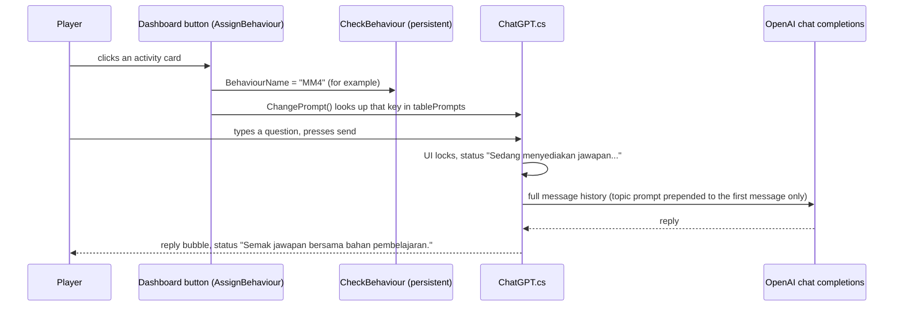
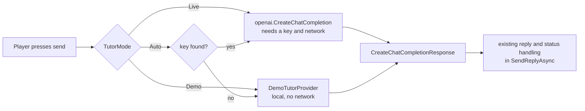

# Evergreen trailer: implementation plan

Status: **plan only. Nothing in this document has been built or run.** Every task below is unchecked. Facts in "Current state" come from reading source files on 2026-11-08 (and `ChatGPT.cs` again on 2026-11-09 for section 11), not from running the game.

Revision 2026-11-09: added a **demo tutor mode** (section 11, Phase D). It lets anyone run the open-source project without their own OpenAI key. It is a separate deliverable from the film: **the trailer never contains demo-mode answers.** Nothing in section 11 has been implemented; it needs owner approval first because it changes game code (see section 9).

## 1. Objective

Make a fun, fast-to-read video that shows the Evergreen virtual lab being used, then shows the AI tutor being used, then explains how the tutor works without overstating it. The audience is a portfolio visitor on GitHub or YouTube, so the film must be self-explanatory with the sound off.

| Deliverable | Length | Required |
|---|---|---|
| **Master trailer**: lab, quiz, AI tutor, how it works, end card | about 90 s, 1920×1080, 60 fps, MP4 | Yes |
| README loop: 8 to 10 s silent GIF or MP4 of the best AI exchange | under 10 MB | Yes |
| Social cut | 30 to 45 s | Optional |
| Interactive companion page (see section 7) | n/a | Optional, off by default |

## 2. Current state (verified by reading source)

### 2.1 How the AI tutor works today

Source: `Assets/Samples/OpenAI Unity/0.2.2/ChatGPT/` (`ChatGPT.cs`, `AssignBehaviour.cs`, `CheckBehaviour.cs`).



| Fact | Evidence |
|---|---|
| 14 topic prompts exist: `defaultPrompt`, `Dashboard`, `Akt1` to `Akt7`, `MM3` to `MM7`. Each tells the model to act as a scientist, stay in character, refuse non-science questions, and explain one named activity or experiment. | `tablePrompts` in `ChatGPT.cs` |
| The topic comes from the **button the player clicked**, not from reading the screen. Only six `AssignBehaviour` buttons exist, all in `Dashboard.unity`: `Akt1`, `MM3`, `MM4`, `MM5`, `MM6`, `MM7`. | Search of all scenes and prefabs |
| The prompt is sent as part of the **first user message** of a session (`messages.Count == 0`). The history is never cleared, so changing topic later does not re-prime the conversation. | `SendReplyAsync` |
| The model is a serialized field, default `gpt-6-luna`, so the account needs access to it. | `ChatGPT.cs` line 28 |
| The assistant lives in a `DontDestroyOnLoad` canvas, so one chat persists across scenes. | `DontDestroyCanvas.cs`, README |
| The key comes from `OPENAI_API_KEY` or `~/.openai/auth.json`. | `docs/OPENAI_SETUP.md` |
| The request call is passed into `SendReplyAsync(Func<CreateChatCompletionRequest, Task<CreateChatCompletionResponse>>)`. `SendReply()` is the only caller and passes `openai.CreateChatCompletion`. This is the seam a demo provider can use without touching the chat UI. | `ChatGPT.cs` lines 149 to 156 |
| With no key the request should fail and the status line should read "Jawapan tidak dapat dimuatkan. Cuba lagi." There is no built-in way to try the chat without a key. **Inferred from the error branches; not run.** | `ChatGPT.cs` lines 182 to 203 |

### 2.2 What the film may and may not claim

| Say this | Do not say this |
|---|---|
| "Topic-aware: it knows which activity you opened." | "Sees your screen", "knows what step you are on", "reads your experiment state" |
| "Stays in character as a science tutor and declines non-science questions." | "Always correct", "curriculum-verified", "never wrong" |
| "Answers in context of 14 activity and experiment prompts." | "Trained on the lesson content", "retrieval", "RAG" |
| "Powered by OpenAI chat completions, called from Unity C#." | A model name unless Phase 0 confirms it is the one used |

### 2.3 Other facts that shape the shoot

- Only the Dashboard and the first akt4 steps have the science-themed restyle. `IMPLEMENTATION.md` at the repo root has 48 tasks done and 43 open. Unrevamped scenes will look different from restyled ones.
- The README lists Windows and Android as platforms. The active build target is not yet checked.
- `.gitignore` has no video rules, and GitHub already warned about large files on the last push.
- Available on this machine: `ffmpeg`, `node`/`npx`, `python`. No Unity Recorder package is in `Packages/manifest.json`.
- `AGENTS.md` says not to expand tutor service behavior during UI restyling. This plan changes no game code.

## 3. Story and shot list

Principles carried over from the `game-trailer` skill (which targets browser games, so only the editorial rules apply): readable before fast, shots about 1 to 2.5 s, say what the thing is in the first seconds, show full-screen play before zooming, and end on a payoff. All footage is real gameplay; no mock-ups and no generated screens.

Working title: **"Ask the lab."** Tagline: *Do the experiment. Ask the tutor. Test yourself.*

| # | Time | Beat | On screen (real capture) | Caption (English; game UI stays Malay) |
|---|---|---|---|---|
| 1 | 0:00 to 0:05 | Hook | Dashboard opens, cursor sweeps the activity cards | "A virtual science lab in Bahasa Malaysia" |
| 2 | 0:05 to 0:15 | Choose | Hover and click Aktiviti 4, lesson page, "Mula eksperimen" | "Pick an activity. Read. Then do it." |
| 3 | 0:15 to 0:38 | Do the lab | akt4 cloning: drag apparatus onto targets; correct drop shown at 0.5× speed | "Drag the apparatus. The lab checks every step." |
| 4 | 0:38 to 0:46 | Test | *Uji Diri*: pick an answer, feedback, score | "Then test yourself." |
| 5 | 0:46 to 1:08 | **Ask the tutor** | Open Pembantu pembelajaran; type a real question; status line; reply scrolls in. Second question. Off-topic question gets declined | "Stuck? Ask. It knows which activity you opened." |
| 6 | 1:08 to 1:22 | **How it works** | Animated diagram built from the real flow in 2.1, with the real prompt keys and class names | "Your click picks a topic prompt. Your question goes with it." |
| 7 | 1:22 to 1:30 | Payoff | Best tutor answer as a final hold, then end card | "Unity 6, OpenAI, Claude Code + Unity MCP. github.com/Azrinfreeman/evergreen-ai-virtual-lab" |

Candidate tutor questions (final picks after Phase 0 and real tries; the Malay wording is mine, so the owner reviews it):

| Screen | Question | Purpose |
|---|---|---|
| After clicking MM4 | "Kenapa kita guna enzim sekatan?" | Shows on-topic cloning answer |
| After clicking MM4 | "Apakah GFP?" | Second turn keeps context |
| Same session | "Siapa menang Piala Dunia 2022?" | Shows the science-only scope |

Rules for the AI beat: the reply text on screen is exactly what the model returned, never retyped or trimmed. Pick among several real takes; keep each transcript (section 5, task 3.4). If the model gives a weak answer, retake rather than edit.

## 4. Technical approach

| Stage | Choice | Why | Alternative |
|---|---|---|---|
| Game under test | Windows standalone **development build** at 1920×1080 windowed, output to `Builds/` outside `Assets/` | No Editor chrome, stable resolution | Editor Game view if the active target is Android (switching target reimports the whole project; avoid) |
| Recording | `ffmpeg -f gdigrab` at 60 fps, high-quality H.264 (CRF 14) intermediates, cursor included | Already installed, no package change | Unity Recorder package (needs manifest change, ask first) |
| Input | PowerShell script using `user32` mouse and key calls, eased cursor paths, one script per take | Repeatable takes, no installs | Owner plays the takes by hand while recording |
| Edit | **Remotion** project in `trailer/edit/` (React, deterministic render) for captions, zoom crops, diagram, end card | Code-defined and editable; see the repo's Remotion skills | ffmpeg-only concat (plainer, no diagram animation) |
| Music | Original score synthesized in Python/numpy, 96 to 100 BPM, cuts on beats | No licensing risk | Licensed track with proof of license kept in `trailer/` |
| Sound | The game's own UI and drop sounds if present, plus synthesized transition hits | Matches the product | Silent with music only |
| Render | 1080p60, H.264 CRF 16, plus a 720p preview under 20 MB | Same split as the skill | |

Anything that needs `npm install`, a new package, or a build target change waits for the owner's go-ahead at the start of execution.

## 5. Tasks

### Phase 0: Preflight (no footage yet)

- [ ] 0.1 Rotate the exposed OpenAI key and place the new one per `docs/OPENAI_SETUP.md`. Expect: a one-line test question in the Editor gets a reply. The film still needs a real key and the live tutor; demo mode (section 11) does not replace this task.
- [ ] 0.2 Confirm the model ID in the `ChatGPT` component works on this account. Expect: reply, no error status line. Record the actual model name used.
- [ ] 0.3 Read `CheckBehaviour.BehaviourName` default in the scene and prefab. Expect: know which prompt is active when the player opens the chat without clicking a card.
- [ ] 0.4 Confirm which screens the shoot can reach: Dashboard to akt4, a quiz, and the assistant. Note any that are unrestyled or have Console errors.
- [ ] 0.5 Check the active build target and that a Windows development build succeeds. Expect: playable build in `Builds/`.
- [x] 0.6 Inventory the game's own audio clips. `touchglass.wav` (0.24 s UI transient) and `yay.mp3` (1.31 s correct-answer cheer) are used; `salah.mp3` and `kids_clips_pixabay.wav` are documented but not used.
- [ ] 0.7 Decide the open questions in section 9.

### Phase 1: Capture rig

- [ ] 1.1 Create `trailer/` with `capture/`, `edit/`, `audio/`, `raw/`, `out/`. Add `trailer/raw/`, `trailer/out/` and `Builds/` to `.gitignore`.
- [ ] 1.2 Write the ffmpeg capture command and the cursor/key driver. Smoke test at 1280×720: a 10 s clip with cursor motion and one typed sentence plays back correctly.
- [ ] 1.3 Check DPI scaling and focus: the player window is exactly 1920×1080 on the captured display, and no other window steals focus mid-take.
- [ ] 1.4 Check the screen for secrets: no key, Inspector, console path or personal data visible in any take.

### Phase 2: Takes

Each take is a script file in `trailer/capture/takes/`, run against a fresh app launch.

- [ ] 2.1 `dashboard`: sweep, hover, click into Aktiviti 4.
- [ ] 2.2 `akt4`: the drag-and-drop steps, including one deliberate wrong drop if the game shows feedback for it (verify first).
- [ ] 2.3 `quiz`: one question, an answer, feedback, score.
- [ ] 2.4 `tutor-on-topic`: click the MM4 card, open the chat, ask two questions. Three takes minimum.
- [ ] 2.5 `tutor-off-topic`: same session, one non-science question. Three takes minimum.
- [ ] 2.6 For every tutor take, save the typed question and the returned reply to `trailer/capture/transcripts/<take>.md`. Expect: each on-screen reply is traceable to a transcript.
- [ ] 2.7 Contact sheet of each take (one frame per second) and review: every action visible, nothing cut off, no Console error overlay.

### Phase 3: Edit and score

- [ ] 3.1 Create the Remotion project and import the takes. Expect: a still of shot 1 renders.
- [ ] 3.2 Cut shots 1 to 5 to the beat map in section 3. Expect: no shot under 0.5 s, footage at or below real speed except the deliberate 0.5× drop.
- [ ] 3.3 Build the diagram scene from the real flow in 2.1. Expect: each label matches a real class, field or key in the source.
- [ ] 3.4 Write captions and the end card. Expect: every claim passes the table in 2.2.
- [x] 3.5 Synthesize the score and mix with the game sounds. Game UI/drop and correct-answer sounds plus synthesized cues are placed in `Trailer.tsx`; the score ducks under the quiz cheer. Measured true peak: -3.8 dBFS.

### Phase 4: Review and deliver

- [ ] 4.1 Render a 720p preview and watch it fully with sound on, then with sound off. Expect: the story reads both ways.
- [ ] 4.2 Check the pace: contact sheet of the whole cut every 0.75 s, and a table of shot lengths. Expect: no unreadable blur, median shot 1.4 to 2.5 s.
- [ ] 4.3 Owner review round. Their reply becomes the next cut's brief.
- [x] 4.4 Render the final 1080p60 and the README loop. Files and metadata are recorded in the Phase 3 status below.
- [x] 4.5 Publish in the README: the owner chose repository-linked files instead of YouTube or a GitHub Release. `trailer.mp4`, `readme-loop.mp4` and the poster are unignored and linked from `README.md`; raw footage and previews remain ignored.
- [ ] 4.6 Update this file with what was run, what was verified, and what was not.

### Phase D: Demo tutor mode (independent of the film; design in section 11)

Gate: owner approves section 11 first. Run in this order. Each task has an expected result.

**Update 2026-11-09 (owner decision):** the film is made without a key, using scripted tutor replies with no on-screen "demo" label. This replaces the earlier rules "trailer never contains demo answers", "reply text exactly as returned" and the `Tutor mode: Live` abort guard (D.10). Conditions that still apply: no caption says the exchange is live, real-time or unedited; the end card or video description carries one line such as "Tutor exchange shown is scripted for this trailer; the app uses OpenAI with your own key"; the notice stays on for the shipped app (`Hide Demo Notice` is for recording only). Phase 0.1 and 0.2 (key tasks) are optional for the film. Built and verified so far: D.1 to D.5, D.6 (MM4 only), D.8. See `docs/tutorial/tutor-demo-mode.md`.

- [x] D.1 (done 2026-11-09: a response can be built; `CreateChatCompletionResponse`, `ChatChoice`, `ChatMessage` are public structs with public setters; the package reads the key only through `OpenAIApi(apiKey)` or `~/.openai/auth.json`) Read the OpenAI-Unity package source for `OpenAIApi` key loading and for how `CreateChatCompletionResponse`, `Choices` and `ChatMessage` are constructed. Expect: a written answer to "can a response object be built in our own code?" and "how do I detect that no key exists without printing it?". If a response cannot be built, section 11.2 changes to a wrapper type; stop and report.
- [ ] D.2 Write the content in `DemoTutorScript` (section 11.3) from text already in the project: the topic prompts in `ChatGPT.cs` and the lesson and procedure text in the scenes. Expect: every answer traces to a source line listed in the asset's notes; the owner reviews all Malay text before it ships.
- [ ] D.3 Add the matcher as plain C# with no Unity or network types (section 11.4). Expect: Edit Mode tests pass for exact question, reworded question, no match, off-topic, empty input, and unknown behaviour key.
- [ ] D.4 Add `TutorMode` (`Auto`, `Live`, `Demo`) and the provider switch to `ChatGPT.cs` (section 11.2). Expect: with `Live` and a key, behavior is identical to today; with `Demo`, no network call is made (check with the network disabled).
- [ ] D.5 Add the visible demo label (section 11.5). Expect: the status line says demo mode is on after every reply; the label text is an editable serialized field.
- [ ] D.6 Play Mode check in the Editor with `Mode = Demo`: Dashboard, click MM4, open the chat, ask each sample question, one off-topic question, one unknown question, then leave and enter an experiment scene. Expect: statuses change in the right order, the UI locks while "thinking", bubbles scroll, chat persists across scenes, Console has no errors.
- [ ] D.7 Check `Auto`: with the key unset the chat uses demo; with a key set it uses live. Test the unset case by running with `OPENAI_API_KEY` empty **and** `~/.openai/auth.json` absent or temporarily renamed (ask first; never open or print its contents).
- [ ] D.8 Write the feature guide `docs/tutorial/tutor-demo-mode.md` and update `docs/OPENAI_SETUP.md` with a short "Run without a key" section (section 11.7). Expect: a new contributor can run the tutor with no key using only the guide.
- [ ] D.9 Capture the **showcase** images (section 11.6) into `docs/tutorial/img/`, named `demo-*`. Expect: every image shows the demo label; none are placed under `trailer/`.
- [ ] D.10 SUPERSEDED (owner decision 2026-11-09): replaced by the capture setting `Hide Demo Notice` on the `ChatGPT` component and the disclosure line in the end card or description. Add the disclosure line when the end card is built.
- [ ] D.11 Update this file with what was run and what was not.

## 6. Repository layout

```
trailer/                 source for the film, kept in git
  capture/               ffmpeg command, input driver, takes/, transcripts/
  edit/                  Remotion project: shots, captions, diagram, end card
  audio/                 score script and mix settings
  raw/                   recorded takes (gitignored)
  out/                   renders (gitignored)
docs/trailer/IMPLEMENTATION.md   this plan
docs/tutorial/tutor-demo-mode.md feature guide (Phase D, not yet written)
docs/tutorial/img/               demo-mode showcase images (Phase D, never used by the film)
Assets/Samples/OpenAI Unity/0.2.2/ChatGPT/Demo/   demo script asset, matcher, tests (Phase D, not yet created)
```

`trailer/` sits outside `Assets/` so Unity never imports it. Recorded footage and renders stay out of git; the source regenerates them.

## 7. "Interactive": what that can mean

A video cannot take input, so "interactive" is covered two ways.

| Option | What it is | Cost | Recommendation |
|---|---|---|---|
| **Shown interaction** (default) | The film shows real cursor-driven play and a real back-and-forth with the tutor | Included | Do this |
| Interactive explainer page | A small HTML page where the viewer clicks a topic and sees which prompt the tutor would receive, using the real 14 prompts, with no live API call | Extra half-day, no key exposed | Offer after the film ships |
| Live web demo of the tutor | A hosted chat endpoint | Needs a backend that holds the key, plus abuse limits | Not recommended |

## 8. Risks

| Risk | Effect | Mitigation |
|---|---|---|
| Key or model unavailable | No tutor footage | Task 0.1 and 0.2 gate everything else |
| Replies are non-deterministic | Weak or off-tone answer on camera | Multiple takes, keep transcripts, never edit reply text |
| Chat history persists across scenes | Second topic is not re-primed, so a "switch topic" demo would mislead | Use a fresh launch per tutor take; do not film a topic switch |
| Mixed old and new UI styles | Looks inconsistent | Film restyled screens only now; the scripted takes can be re-run after more of the revamp lands |
| Wrong DPI or focus | Cropped or interrupted capture | Task 1.3 |
| Secrets visible | Key leak on a public video | Task 1.4, and review every frame of the final |
| Curriculum images or text on screen | Rights question for a public repo | Owner confirms before publishing (also flagged earlier for the repo) |
| Music rights | Takedown | Original score or a licensed track with proof |
| Malay captions or questions are mine | Wrong terminology | Owner reviews all Malay text; flag curriculum terms |
| Demo answers end up in the film | A scripted answer presented as the AI, which breaks the "reply text exactly as returned" rule | Trailer build forces `Live`; take script aborts on a non-live log; demo images live only in `docs/tutorial/img/` (D.9, D.10) |
| Demo mode mistaken for the real tutor | Users think canned text is model output | Always-visible demo label; guide and README say plainly that demo answers are fixed text |
| `Auto` picks live when the owner expects demo (or the reverse) | Surprise network call or a surprise canned reply | Log one line at startup: "Tutor mode: Live" or "Tutor mode: Demo (no key found)"; never log the key |
| Demo answers contain a curriculum error | Wrong science taught | Answers use only text already in the project; owner reviews; label says "jawapan contoh" |
| Game-code change breaks the live tutor | Film footage and real users affected | Minimal diff in `ChatGPT.cs`; D.4 compares live behavior before and after |

## 9. Decisions needed from the owner

| Decision | Default if no answer |
|---|---|
| Caption language: English, Malay, or both | English captions, in-game text stays Malay |
| Voiceover | None; captions and music only |
| Length | 90 s master, optional 30 to 45 s cut |
| Shoot now with the partial revamp, or after more scenes are restyled | Now, using Dashboard and akt4 only |
| Where to host the final | YouTube, linked from the README |
| OK to `npm install` Remotion and to build a Windows dev build | Ask again at start of Phase 1 |
| Approve Phase D: a small change to `ChatGPT.cs` plus new files under `.../ChatGPT/Demo/` (`AGENTS.md` says not to expand tutor behavior during restyling, so this is a separate, explicit approval) | Do not start Phase D |
| Default `TutorMode` for new clones | `Auto` (live when a key exists, demo otherwise) |
| Demo answer language | Malay only, same as the game UI |
| How many topics get demo answers first | MM4 in full (5 questions) plus 1 to 2 each for MM3, MM5, MM6, MM7, Akt1; the rest fall back to the generic reply |
| Demo label wording | "Mod demo: jawapan contoh, bukan daripada model AI." (owner may reword) |

## 10. Tutor issues found while planning (not part of this task)

Listed so they are not lost; none are changed here.

- `Akt2` to `Akt7` and `Dashboard` prompts exist, but no button in any scene selects them. Only `Akt1` and `MM3` to `MM7` are wired.
- The topic prompt is applied once per session, and the history is never reset on topic change.
- The prompt is sent as a user message, not a system message, so it is less reliable at holding the role.
- The `Dashboard` prompt says "Aktiviti 1 to Aktiviti 8" but lists seven.
- The prompts tell the model never to mention being an AI. The film labels the tutor as AI regardless.

Fixing these changes service behavior, which `AGENTS.md` asks to avoid during restyling, so it needs a separate decision.

## 11. Demo tutor mode

**Status: design only. No code, asset or test exists yet.**

### 11.1 Why, and what it is not

The tutor needs each user's own OpenAI key. For an open-source project that means a clone cannot show the chat at all, and a reviewer without a key sees only an error line. Demo mode gives the chat a **local, scripted reply source** so the whole flow (pick a topic, open the chat, ask, wait, read) can be run and checked with no key and no network.

| Demo mode is | Demo mode is not |
|---|---|
| Fixed Malay answers written ahead of time, matched to the question by keywords | An AI, a model, or a cached model output |
| Per topic, using the same behaviour keys as the live tutor (`MM3` to `MM7`, `Akt1`, ...) | Aware of the screen, the experiment step, or the player's progress |
| Labelled on screen as demo, always | Allowed in the trailer, in any form |
| A way to test and showcase the chat UI | A replacement for Phase 0 or for real tutor footage |

### 11.2 How it plugs in



- `SendReplyAsync` already accepts the completion call as a `Func`. Demo mode supplies a different `Func` that returns the same response type, so the existing UI lock, bubble and status code run unchanged. The planned diff in `ChatGPT.cs` is small: a serialized `TutorMode` field, one method that picks the `Func`, and one startup log line. (Task D.1 confirms a response object can be built; if not, this section changes.)
- `Auto` means "live when a key exists, demo otherwise". Key detection reads only whether `OPENAI_API_KEY` is non-empty or `~/.openai/auth.json` exists. It never opens, logs or displays the key.
- Startup logs exactly one line: `Tutor mode: Live` or `Tutor mode: Demo (no key found)` or `Tutor mode: Demo (forced)`.
- The topic still comes from `CheckBehaviour.BehaviourName`, exactly as in 2.1, so the demo is topic-aware in the same limited way as the live tutor. It does not make the tutor look smarter than it is.
- Live behavior, the `tablePrompts` table and the key handling are not changed.

### 11.3 Where the answers live (editable in the Inspector)

One ScriptableObject, `DemoTutorScript`, in `Assets/Samples/OpenAI Unity/0.2.2/ChatGPT/Demo/`, assigned on the `ChatGPT` component.

| Field | Meaning |
|---|---|
| `topics[]` | One entry per behaviour key (`MM4`, ...). Key matching is case-insensitive, like `TryGetKeyById` |
| `topics[].entries[]` | `keywords[]` (any-of words or short phrases), `answer` (Malay text), `source` (where in the project the facts come from; not shown to the player) |
| `topics[].fallback` | Reply when nothing matches; lists the sample questions for that topic |
| `genericFallback` | Reply for an unknown behaviour key |
| `declineEntries[]` | Keywords for off-topic questions (for example "piala dunia") and the decline reply |
| `thinkingSeconds` | Simulated wait (default 0.8 s) so the real "Sedang menyediakan jawapan..." state is visible; 0 in tests |
| `demoLabel` | The label text from the decision table in section 9 |

Content rules:
- Answers use only facts already in the project: the objective and procedure text in the scenes, and the lines in `tablePrompts`. For MM4 that is pUC19, the GFP gene, restriction digestion (XbaI, HindIII), T4 DNA ligase, heat shock at 42 °C, ampicillin plates and UV confirmation.
- Short (2 to 4 sentences), plain Malay, units and symbols as in the scene text.
- First pass: MM4 with five questions (what is GFP, why restriction enzymes, what does ligase do, why heat shock, why ampicillin plates). One or two each for MM3, MM5, MM6, MM7 and Akt1. Everything else uses the fallback.
- The owner reviews every answer before it ships; uncertain curriculum terms are flagged, not guessed.

### 11.4 Matching (plain C#, unit-tested)

1. Normalize the question: lowercase, trim, collapse spaces, strip punctuation.
2. Score each entry in the active topic by how many of its keywords appear; highest score wins; ties go to the earlier entry.
3. No hit in the active topic: check `declineEntries`; if matched, send the decline reply.
4. Still nothing: send the topic `fallback` (or `genericFallback`).
5. Empty or whitespace input is ignored, as in the live path.

The matcher takes strings and the script data and returns a string. It has no Unity, UI or network types, so Edit Mode tests can run it directly (use the `unity-testing` skill when writing them).

### 11.5 What the player sees

Same chat window, same bubbles, same Malay status lines as live mode. The only differences:

- After each reply the status line shows the demo label instead of "Semak jawapan bersama bahan pembelajaran." The label is always visible while demo mode is active.
- Replies start after `thinkingSeconds`, during which the input is locked as today.
- No new buttons, screens or settings UI. The mode is chosen on the `ChatGPT` component, by `Auto`, or by environment.

### 11.6 Showcase, and keeping it out of the trailer

The owner asked to see how demo mode works and how the real tutor works, without exposing a key. The showcase is documentation, not film.

| Piece | Content | Location |
|---|---|---|
| Two-path diagram | The flowchart in 11.2 plus the live sequence from 2.1, side by side | `docs/tutorial/tutor-demo-mode.md` |
| Annotated screenshots | Real Game-view captures of the demo chat: topic chosen, question typed, "thinking" status, reply with the demo label, and an off-topic decline. Each is captioned "Demo mode: fixed sample answer" | `docs/tutorial/img/demo-*.png` |
| Walkthrough | The exact questions to type to reproduce each screenshot | same guide |
| Live comparison | A text-only note describing what changes with a key (reply comes from the model; varies per run). No live screenshots are published until Phase 0 and the owner's review | same guide |

Separation rules for the film:

- Trailer builds set `TutorMode = Live`. Tutor take scripts read the player log and abort before recording unless it contains `Tutor mode: Live`.
- Transcripts for tutor takes (task 2.6) record `mode: live` and the model name.
- Nothing from `docs/tutorial/img/` is imported into `trailer/`. The "how it works" diagram scene (shot 6) may mention that a key is required, but does not show demo replies.
- If the owner later wants to disclose demo mode in the film, that is a new decision, not a default.

The optional interactive explainer page in section 7 can reuse `DemoTutorScript` content, but only with the same demo label.

### 11.7 Docs to update when this is built

| File | Change |
|---|---|
| `docs/OPENAI_SETUP.md` | Add "Run without a key": how `Auto` behaves, how to force `Demo` or `Live`, the demo label, and that replies are fixed text |
| `docs/tutorial/tutor-demo-mode.md` | New feature guide: what it does, files, how to add a topic or question, how to test, what was verified, limits |
| `README.md` | One short pointer to the guide; no claim that the tutor works without a key beyond "demo mode with fixed sample answers" |
| This file | Tick Phase D only with evidence |

### 11.8 Verification plan (what "done" will mean)

- Edit Mode tests for the matcher pass, and the list of test cases is in the guide.
- A Play Mode run in the Editor with `Mode = Demo` completes the flow in D.6 with no Console errors, and the network is off during at least one run.
- `Mode = Live` with a valid key behaves as before (compare one reply path before and after the change).
- `Auto` is tested both with and without a key (D.7), without ever displaying the key.
- Screenshots are viewed, not assumed, and each shows the demo label.
- Not verified until run: Android behavior, any build other than the Editor, and the live tutor itself (that still waits on Phase 0).

## Phase 3 status (edit)

- Takes were checked on contact sheets (`trailer/raw/sheets/`): no T3 window, desktop content or key visible.
- Remotion project: `trailer/edit/`. `src/Trailer.tsx` holds the clip table, captions, sound cues, diagram and end card. `src/ReadmeLoop.tsx` is the separate 10-second tutor loop. `scripts/gen-score.mjs` and `gen-cue.mjs` write the synthesized audio. `public/` is git-ignored; regenerate its footage from `trailer/raw/` and its logo from the official URL in `PUBLISHING.md`.
- Cut: 50 s (20 bars), English captions, not the 1:30 shot list. Every cut lands on a bar boundary.
- Tutor shots name OpenAI and the configured model `gpt-6-luna` (from `ChatGPT.cs` and `ChatGPT.prefab`). The owner confirmed the model ID on 2026-11-09; no independent API test was run. The scripted-exchange disclosure stays on the end card and README loop.
- The official OpenAI wordmark from openai.com/brand appears on the end card with a trademark acknowledgement. It is not more prominent than the Evergreen title.
- Sound: the game's `touchglass.wav` and `yay.mp3`, plus a synthesized two-note cue. `salah.mp3` was not used for the tutor decline because that would suggest a wrong answer. The score ducks under the quiz cheer. Final audio measures -19.2 LUFS integrated and -3.8 dBFS true peak, with no clipping.
- Final: `trailer/out/trailer.mp4`, 1920x1080, 60 fps, 50 s, 4.52 MB. Preview: `preview.mp4`, 960x540, 2.51 MB. README loop: `readme-loop.mp4`, 1280x720, 30 fps, 10 s, silent, 0.14 MB. All are git-ignored. Commands: `npm run render`, `npm run preview`, `npm run loop` in `trailer/edit`.
- Malay scripted answers received limited language edits, listed in `docs/tutorial/tutor-demo-mode.md`; all 10 Edit Mode tests passed with no Console errors. The owner approved the wording and final review, including curriculum-image permission, on 2026-11-09.
- Publishing copy is in `docs/trailer/PUBLISHING.md`. On 2026-11-09 the owner chose to include the final MP4, README loop and poster in the repository and link them from the root `README.md`; `.gitignore` keeps raw footage, previews and QA output excluded.
- Key revocation was explicitly excluded from this pass.
